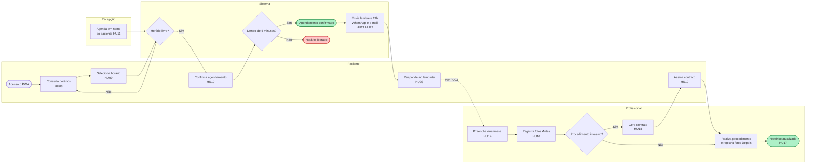

# Descrição do projeto
---

## Objetivo
Entregar uma plataforma web instalável (*PWA*) para clínicas de estética que centraliza o fluxo do paciente, da marcação ao pós-procedimento: agenda por profissional sem marcações duplicadas, documentação clínica essencial (anamnese, fotos "Antes" e "Depois", histórico), contratos com assinatura digital para procedimentos invasivos e lembretes automáticos para reduzir faltas.

## Contexto e dores
- Agendamentos duplicados quando dois pacientes ou atendentes escolhem o mesmo horário ao mesmo tempo.
- Absenteísmo: pacientes esquecem o horário ou não confirmam presença.
- Documentação clínica (anamnese, fotos de evolução) dispersa, sem histórico único por paciente.
- Insegurança jurídica em procedimentos invasivos sem contrato assinado e guardado de forma íntegra.
- Dados de saúde e imagens de pacientes exigem tratamento conforme a LGPD.

## Benefícios
- Eliminação de marcações duplicadas: quem escolhe o horário primeiro tem a prioridade.
- Redução de faltas com lembrete por WhatsApp e e-mail 24 horas antes e inclusão do compromisso na agenda do paciente.
- Histórico clínico único por paciente, com fotos de evolução.
- Contratos assinados guardados sem possibilidade de alteração, fortalecendo a segurança jurídica.
- Acesso pelo navegador ou pela tela inicial do celular, sem download em loja de aplicativos.

## Escopo
**Contempla (MVP)**
- Agenda independente por profissional, com reserva temporária de 5 minutos do horário selecionado até a confirmação.
- Agendamento pelo próprio paciente e pela recepção.
- Painel do profissional com a grade diária.
- Formulários de anamnese **fixos**, com exportação em PDF.
- Histórico individual do paciente com envio simples de fotos "Antes" e "Depois".
- Gerador de contratos parametrizável para procedimentos invasivos, com assinatura por *touchscreen* no dispositivo do atendimento.
- Lembrete automático por WhatsApp (com pedido de confirmação) e por e-mail com anexo de calendário, 24 horas antes do atendimento.
- Controle de acesso por perfil e proteção de dados sensíveis conforme a LGPD.

**Não contempla (entregas futuras, previstas na proposta)**
- Visões semanal e mensal da grade do profissional (PA11).
- Construtor de formulários de anamnese, modelos reutilizáveis por procedimento, marcações anatômicas e importação de documentos legados (PA01).
- Anamnese prévia e contrato enviados por link ao paciente após o agendamento (PA08, PA15).
- Assinatura remota de contrato por link no e-mail ou no WhatsApp (PA16).
- Registro de produtos, marcas, lotes e insumos aplicados e observações do profissional por sessão (PA12).
- Fotos vinculadas à sessão de atendimento (PA13).
- Comparador visual lado a lado ou com controle deslizante das fotos de evolução (PA02).
- Marca d'água automática da clínica nas fotos exportadas para marketing, com consentimento do paciente (PA17).
- Arquivo de calendário ou botão "Adicionar à minha agenda" já na confirmação do agendamento (PA04, PA14).
- Notificações *push* nativas (PA03) e cache *offline* básico (PA18).

**Não contempla (não citados nas fontes)**
- Financeiro, pagamentos, estoque e comissões.

## Perfis de usuário
| Perfil | Área | O que faz no sistema |
|--|--|--|
| Paciente | Externo | Cadastra-se, consulta e reserva horários, confirma presença, assina contratos, recebe lembretes. |
| Recepção | Atendimento da clínica | Cadastra pacientes, agenda em nome deles e acompanha as confirmações. |
| Profissional | Equipe clínica | Consulta a própria grade, preenche anamnese, registra fotos, consulta histórico e emite contratos. |
| Administrador da clínica | Gestão da clínica | Cadastra profissionais, grades, procedimentos, modelos de contrato, usuários e perfis de acesso. |

## Aplicações envolvidas
- Plataforma web/PWA de gestão da clínica — aplicação nova, objeto deste projeto.
- WhatsApp — canal de envio do lembrete e do pedido de confirmação.
- E-mail transacional — canal de envio do lembrete com anexo de calendário.
- Google Agenda / Apple Calendar — agendas do paciente que recebem o compromisso pelo anexo.

## Requisitos não funcionais
1. Funcionar como *PWA*: carregamento rápido e instalação na tela inicial de celulares, sem loja de aplicativos.
1. Conformidade com a LGPD e com as normas de dados de saúde.
1. Criptografia de ponta a ponta para fotos e informações sensíveis (ver PA06).
1. Armazenamento não editável dos termos e contratos assinados.
1. Controle de acesso baseado em papéis (perfis).
1. Alta disponibilidade para suportar o volume de acessos simultâneos à agenda.

## Fluxo
1. O paciente (ou a recepção, em nome dele) consulta os horários livres e seleciona um.
1. O sistema reserva o horário por 5 minutos para quem selecionou primeiro; para os demais, ele aparece indisponível.
1. Confirmado dentro do prazo, o agendamento é gravado e a disponibilidade é atualizada para todos; fora do prazo, o horário é liberado.
1. 24 horas antes, o paciente recebe o lembrete por WhatsApp, com pedido de confirmação, e por e-mail, com o anexo de calendário.
1. No atendimento, o profissional preenche a anamnese e registra as fotos "Antes".
1. Se o procedimento for invasivo, o contrato é gerado e o paciente assina no dispositivo.
1. Após o procedimento, o profissional registra as fotos "Depois"; tudo fica no histórico do paciente.

# Regras de negócio
---
| ID | Regra | Origem |
|--|--|--|
| RN01 | Cada profissional tem agenda própria e independente; a disponibilidade é calculada por profissional. | Descrição do projeto |
| RN02 | Ao ser selecionado, o horário fica reservado por 5 minutos para quem o selecionou e aparece indisponível para os demais. | MVP |
| RN03 | Tem prioridade quem selecionou o horário primeiro; em seleções simultâneas, apenas a primeira é aceita. | MVP |
| RN04 | A reserva não confirmada em 5 minutos expira e o horário volta a ficar disponível. | MVP |
| RN05 | Um horário de um profissional admite um único agendamento confirmado; a confirmação é gravada por inteiro ou não é gravada. | Descrição do projeto |
| RN06 | Após a confirmação, a disponibilidade é atualizada imediatamente para todos os usuários. | MVP |
| RN07 | O lembrete é enviado por WhatsApp e por e-mail 24 horas antes do atendimento. Os atendimentos das próximas 24 horas são verificados a cada 30 ou 60 minutos, então o envio ocorre até um intervalo depois de completar 24 horas de antecedência (ver PD04). | Descrição do projeto, MVP e proposta |
| RN08 | O lembrete por WhatsApp solicita a confirmação do horário, com as opções "Sim" e "Não". | MVP e proposta |
| RN09 | O e-mail de lembrete traz anexo de calendário compatível com Google Agenda e Apple Calendar. | MVP |
| RN10 | No MVP, a anamnese usa formulários fixos, exportáveis em PDF. | MVP |
| RN11 | As fotos do paciente são classificadas como "Antes" ou "Depois" e ficam no histórico individual do paciente. | MVP |
| RN12 | Procedimentos invasivos têm contrato gerado a partir de modelo parametrizável e assinado digitalmente pelo paciente (ver PD06). | Descrição do projeto e MVP |
| RN13 | Contrato ou termo assinado não pode ser alterado nem excluído; fica vinculado ao perfil do paciente em PDF não editável. | Descrição do projeto e proposta |
| RN14 | Fotos e informações de saúde são dados sensíveis: acesso restrito aos perfis autorizados e protegidos por criptografia. | Descrição do projeto |
| RN15 | As funcionalidades são liberadas conforme o perfil do usuário. | Descrição do projeto |
| RN16 | A duração do horário é definida pelo tipo de procedimento. | Proposta |
| RN17 | O paciente escolhe o procedimento e o profissional e vê o calendário filtrado por eles. | Proposta |
| RN18 | O profissional pode bloquear horários de folga; horário bloqueado não é oferecido para agendamento. | Proposta |
| RN19 | O contrato tem como variáveis: nome do paciente, CPF, procedimento, valor, data e riscos envolvidos. | Proposta |

# Histórias de usuário
---

## Administração da clínica

### HU01 - Configurar a agenda do profissional

**Como** administrador da clínica, **quero** cadastrar o profissional com a sua grade de atendimento, **para** que os horários dele fiquem disponíveis para agendamento.

**Regras relacionadas:** RN01

**Critérios de aceite**
1. **Dado** um profissional cadastrado com grade definida, **quando** o paciente consultar os horários, **então** apenas os horários da grade desse profissional são oferecidos para ele (ver PD11).
1. **Dado** dois profissionais com grades diferentes, **quando** um deles tiver um horário ocupado, **então** a disponibilidade do outro não é afetada.
1. **Dado** um usuário sem o perfil de administrador, **quando** acessar a configuração de profissionais, **então** a ação não é exibida.

### HU02 - Cadastrar procedimentos

**Como** administrador da clínica, **quero** cadastrar os procedimentos oferecidos, com duração e indicação de invasivo, **para** que possam ser agendados e, quando invasivos, exijam contrato.

**Regras relacionadas:** RN12, RN16

**Critérios de aceite**
1. **Dado** um procedimento cadastrado, **quando** o paciente for agendar, **então** o procedimento aparece entre as opções.
1. **Dado** um procedimento com duração de 60 minutos, **quando** o paciente o escolher, **então** só são oferecidos horários com 60 minutos livres seguidos na grade do profissional.
1. **Dado** um procedimento sem duração informada, **quando** o administrador tentar salvar, **então** a gravação é bloqueada e o campo é indicado.
1. **Dado** um procedimento marcado como invasivo, **quando** for realizado um atendimento com ele, **então** o sistema indica que é necessário contrato (ver PD06).
1. **Dado** um usuário sem o perfil de administrador, **quando** acessar o cadastro de procedimentos, **então** a ação não é exibida.

### HU03 - Gerenciar usuários e perfis de acesso

**Como** administrador da clínica, **quero** cadastrar usuários da equipe e atribuir a cada um um perfil, **para** que cada pessoa acesse apenas o que sua função exige.

**Regras relacionadas:** RN14, RN15

**Critérios de aceite**
1. **Dado** um usuário com perfil de recepção, **quando** ele acessar o sistema, **então** vê as funções de cadastro de pacientes e agenda, e não vê anamnese, fotos nem configurações (proposta).
1. **Dado** um usuário com perfil de profissional, **quando** ele acessar o sistema, **então** vê a própria grade e o histórico clínico dos seus pacientes (proposta).
1. **Dado** um usuário desativado, **quando** tentar entrar, **então** o acesso é negado.
1. **Dado** um usuário sem o perfil de administrador, **quando** acessar a gestão de usuários, **então** a ação não é exibida.

### HU04 - Manter modelos de contrato

**Como** administrador da clínica, **quero** cadastrar modelos de contrato com campos variáveis, **para** gerar contratos dos procedimentos invasivos sem redigi-los a cada atendimento.

**Regras relacionadas:** RN12, RN19

**Critérios de aceite**
1. **Dado** um modelo com as variáveis nome do paciente, CPF, procedimento, valor, data e riscos envolvidos, **quando** um contrato for gerado a partir dele, **então** as variáveis são preenchidas com os dados do paciente, do procedimento e do atendimento.
1. **Dado** um modelo sem o texto de riscos do procedimento, **quando** o administrador tentar salvá-lo, **então** a gravação é bloqueada (proposta; ver PD07).
1. **Dado** um modelo alterado, **quando** já existirem contratos assinados com a versão anterior, **então** os contratos assinados permanecem como foram assinados.
1. **Dado** um usuário sem o perfil de administrador, **quando** acessar os modelos de contrato, **então** a ação não é exibida.

## Cadastro e acesso do paciente

### HU05 - Instalar o aplicativo na tela inicial

**Como** paciente, **quero** acessar o sistema pelo navegador e instalá-lo na tela inicial do celular, **para** agendar sem baixar aplicativo em loja.

**Critérios de aceite**
1. **Dado** um paciente acessando pelo navegador do celular, **quando** escolher instalar, **então** o atalho do aplicativo é adicionado à tela inicial.
1. **Dado** o aplicativo instalado, **quando** o paciente o abrir pela tela inicial, **então** ele abre sem a barra do navegador, na tela inicial do sistema.
1. **Dado** um navegador que não permite instalação, **quando** o paciente acessar, **então** consegue usar todas as funções pelo próprio navegador.

### HU06 - Cadastrar-se como paciente

**Como** paciente, **quero** fazer meu cadastro informando meus contatos e aceitando o tratamento dos meus dados, **para** poder agendar e receber lembretes.

**Regras relacionadas:** RN14

**Critérios de aceite**
1. **Dado** um paciente que preencheu os dados obrigatórios e aceitou o termo de consentimento, **quando** concluir o cadastro, **então** pode agendar horários (ver PD09).
1. **Dado** um paciente que não aceitou o termo de consentimento, **quando** tentar concluir o cadastro, **então** o cadastro não é concluído e o motivo é informado.
1. **Dado** um paciente que já possui cadastro com o mesmo contato, **quando** tentar se cadastrar de novo, **então** é orientado a acessar o cadastro existente.

### HU07 - Cadastrar paciente pela recepção

**Como** recepção, **quero** cadastrar um paciente que procurou a clínica por telefone ou presencialmente, **para** agendar em nome dele.

**Regras relacionadas:** RN14

**Critérios de aceite**
1. **Dado** os dados obrigatórios preenchidos, **quando** a recepção salvar, **então** o paciente fica disponível para agendamento (ver PD09).
1. **Dado** um paciente já cadastrado com o mesmo contato, **quando** a recepção tentar cadastrá-lo, **então** o sistema avisa e mostra o cadastro existente.
1. **Dado** um usuário com perfil de profissional, **quando** acessar o cadastro de pacientes, **então** a inclusão não é exibida (proposta).

## Agendamento

### HU08 - Consultar horários disponíveis

**Como** paciente, **quero** ver os horários livres por procedimento e profissional, **para** escolher o que me atende.

**Regras relacionadas:** RN01, RN02, RN06, RN16, RN17, RN18

**Critérios de aceite**
1. **Dado** um procedimento e um profissional escolhidos, **quando** o paciente consultar o calendário, **então** são exibidos apenas os horários livres desse profissional com a duração do procedimento.
1. **Dado** um paciente consultando o calendário, **quando** trocar o filtro de profissional ou de procedimento, **então** os horários exibidos são atualizados conforme o novo filtro.
1. **Dado** um horário bloqueado como folga pelo profissional, **quando** o paciente consultar o calendário, **então** o horário não é oferecido.
1. **Dado** um horário reservado temporariamente por outra pessoa, **quando** o paciente consultar a agenda, **então** esse horário aparece indisponível.
1. **Dado** um horário confirmado por outra pessoa enquanto o paciente está na tela, **quando** a confirmação ocorrer, **então** o horário passa a aparecer indisponível sem que o paciente precise recarregar a página.

### HU09 - Reservar horário temporariamente

**Como** paciente, **quero** que o horário que selecionei fique guardado para mim enquanto concluo a marcação, **para** não perdê-lo para outra pessoa.

**Regras relacionadas:** RN02, RN03, RN04

**Critérios de aceite**
1. **Dado** um horário livre, **quando** o paciente o selecionar, **então** o horário fica reservado para ele por 5 minutos e o tempo restante é exibido (proposta: exibir contagem).
1. **Dado** duas pessoas selecionando o mesmo horário ao mesmo tempo, **quando** as seleções chegarem, **então** apenas a primeira obtém a reserva e a segunda é avisada de que o horário não está mais disponível.
1. **Dado** um horário reservado por outra pessoa, **quando** o paciente tentar selecioná-lo, **então** a seleção é recusada e ele é convidado a escolher outro horário.
1. **Dado** uma reserva não confirmada, **quando** se passarem 5 minutos, **então** a reserva expira e o horário volta a aparecer livre para todos.

### HU10 - Confirmar o agendamento

**Como** paciente, **quero** confirmar o horário reservado, **para** garantir o meu atendimento.

**Regras relacionadas:** RN04, RN05, RN06

**Critérios de aceite**
1. **Dado** uma reserva dentro dos 5 minutos, **quando** o paciente confirmar, **então** o agendamento é gravado e ele recebe a confirmação na tela.
1. **Dado** uma reserva expirada, **quando** o paciente tentar confirmar, **então** a confirmação é recusada e ele é avisado de que precisa escolher o horário de novo.
1. **Dado** uma falha durante a confirmação, **quando** o agendamento não puder ser gravado por inteiro, **então** nada é gravado e o paciente é avisado para tentar novamente.
1. **Dado** um agendamento confirmado, **quando** qualquer outro usuário consultar a agenda, **então** o horário aparece ocupado.

### HU11 - Agendar em nome do paciente

**Como** recepção, **quero** reservar e confirmar horários em nome de um paciente cadastrado, **para** atender quem marca por telefone ou presencialmente.

**Regras relacionadas:** RN02, RN03, RN04, RN05

**Critérios de aceite**
1. **Dado** um paciente cadastrado e um horário livre, **quando** a recepção selecionar e confirmar em até 5 minutos, **então** o agendamento é gravado no nome do paciente.
1. **Dado** um horário que o paciente selecionou pelo aplicativo segundos antes, **quando** a recepção tentar selecioná-lo, **então** a seleção da recepção é recusada (mesma regra de prioridade do paciente).
1. **Dado** um usuário com perfil de paciente, **quando** acessar o sistema, **então** não consegue agendar em nome de outra pessoa.

### HU12 - Visualizar a grade diária

**Como** profissional, **quero** ver a minha grade do dia com os pacientes e procedimentos agendados, **para** organizar meus atendimentos.

**Regras relacionadas:** RN01, RN06, RN15

**Critérios de aceite**
1. **Dado** um profissional com agendamentos no dia, **quando** abrir o painel, **então** vê os horários em ordem, com paciente, procedimento e situação da confirmação.
1. **Dado** um novo agendamento confirmado para ele, **quando** o profissional estiver com o painel aberto, **então** o agendamento aparece sem recarregar a página.
1. **Dado** um profissional, **quando** abrir o painel, **então** não vê a grade de outros profissionais (proposta; ver PD11).

### HU13 - Cancelar ou remarcar agendamento (proposta)

**Como** paciente, **quero** cancelar ou remarcar meu agendamento, **para** liberar o horário quando não puder comparecer.

**Regras relacionadas:** RN06

**Critérios de aceite**
1. **Dado** um agendamento dentro das condições permitidas, **quando** o paciente cancelar, **então** o horário volta a ficar livre para todos (ver PD02).
1. **Dado** um agendamento fora das condições permitidas, **quando** o paciente tentar cancelar ou remarcar, **então** a ação é recusada e ele é orientado a falar com a clínica (ver PD02).
1. **Dado** uma remarcação, **quando** o paciente escolher o novo horário, **então** valem as mesmas regras de reserva temporária e prioridade da HU09.

### HU25 - Bloquear horários de folga

**Como** profissional, **quero** bloquear horários de folga na minha grade, **para** que não sejam oferecidos para agendamento.

**Regras relacionadas:** RN01, RN18

**Critérios de aceite**
1. **Dado** um horário livre na grade, **quando** o profissional o bloquear como folga, **então** o horário deixa de ser oferecido para agendamento imediatamente.
1. **Dado** um horário com agendamento confirmado, **quando** o profissional tentar bloqueá-lo, **então** o bloqueio é recusado e ele é avisado do agendamento existente (proposta).
1. **Dado** um bloqueio de folga, **quando** o profissional o retirar, **então** o horário volta a ser oferecido.
1. **Dado** um profissional, **quando** tentar bloquear horário na grade de outro profissional, **então** a ação não é permitida.

## Atendimento e documentação clínica

### HU14 - Preencher a anamnese

**Como** profissional, **quero** preencher a anamnese do paciente em um formulário fixo, **para** registrar as informações de saúde antes do procedimento.

**Regras relacionadas:** RN10, RN14

**Critérios de aceite**
1. **Dado** um paciente em atendimento, **quando** o profissional abrir a anamnese, **então** é exibido o formulário fixo aplicável (ver PD05).
1. **Dado** um campo obrigatório não preenchido, **quando** o profissional salvar, **então** a gravação é bloqueada e o campo é indicado.
1. **Dado** uma anamnese salva, **quando** o histórico do paciente for consultado, **então** ela aparece com data e profissional responsável.
1. **Dado** um usuário com perfil de recepção, **quando** tentar acessar a anamnese, **então** o conteúdo não é exibido (proposta).

### HU15 - Exportar a anamnese em PDF

**Como** profissional, **quero** exportar a anamnese preenchida em PDF, **para** imprimir ou entregar ao paciente.

**Regras relacionadas:** RN10, RN14

**Critérios de aceite**
1. **Dado** uma anamnese salva, **quando** o profissional pedir a exportação, **então** é gerado um PDF com todas as respostas, os dados do paciente, a data e o profissional.
1. **Dado** uma anamnese ainda não salva, **quando** o profissional tentar exportar, **então** a exportação não é oferecida.
1. **Dado** um usuário sem acesso à anamnese, **quando** tentar exportá-la, **então** a ação não é exibida.

### HU16 - Registrar fotos "Antes" e "Depois"

**Como** profissional, **quero** enviar fotos do paciente classificadas como "Antes" ou "Depois", **para** acompanhar a evolução do tratamento.

**Regras relacionadas:** RN11, RN14

**Critérios de aceite**
1. **Dado** um paciente em atendimento, **quando** o profissional enviar uma foto e marcá-la como "Antes" ou "Depois", **então** a foto fica no histórico do paciente com data e classificação.
1. **Dado** uma foto sem classificação, **quando** o profissional tentar salvá-la, **então** a gravação é bloqueada até escolher "Antes" ou "Depois".
1. **Dado** um arquivo que não é imagem, **quando** o profissional tentar enviá-lo, **então** o envio é recusado com aviso.
1. **Dado** um usuário sem acesso a dados clínicos, **quando** consultar o paciente, **então** as fotos não são exibidas.

### HU17 - Consultar o histórico do paciente

**Como** profissional, **quero** consultar em um só lugar os atendimentos, anamneses, fotos e contratos do paciente, **para** conhecer o histórico antes de atendê-lo.

**Regras relacionadas:** RN11, RN13, RN14

**Critérios de aceite**
1. **Dado** um paciente com atendimentos anteriores, **quando** o profissional abrir o histórico, **então** vê os registros em ordem cronológica, com anamneses, fotos e contratos.
1. **Dado** um paciente sem atendimentos, **quando** o profissional abrir o histórico, **então** é informado de que não há registros.
1. **Dado** um usuário sem acesso a dados clínicos, **quando** tentar abrir o histórico, **então** o acesso é negado.

## Contratos

### HU18 - Gerar contrato do procedimento invasivo

**Como** profissional, **quero** gerar o contrato do procedimento invasivo a partir do modelo, **para** formalizar o atendimento com o paciente.

**Regras relacionadas:** RN12, RN19

**Critérios de aceite**
1. **Dado** um atendimento de procedimento invasivo, **quando** o profissional gerar o contrato, **então** o texto do modelo é exibido com nome do paciente, CPF, procedimento, valor, data e riscos preenchidos.
1. **Dado** um paciente sem CPF no cadastro, **quando** o profissional tentar gerar o contrato, **então** é avisado de que o CPF precisa ser informado.
1. **Dado** um procedimento invasivo sem modelo de contrato cadastrado, **quando** o profissional tentar gerar o contrato, **então** é avisado de que falta o modelo.
1. **Dado** um procedimento invasivo sem contrato assinado, **quando** o profissional tentar registrar o procedimento como realizado, **então** o sistema bloqueia ou alerta (ver PD06).

### HU19 - Assinar o contrato no dispositivo

**Como** paciente, **quero** assinar o contrato com o dedo na tela do dispositivo do atendimento, **para** formalizar meu consentimento sem papel.

**Regras relacionadas:** RN12, RN13

**Critérios de aceite**
1. **Dado** um contrato gerado, **quando** o paciente desenhar a assinatura e confirmar, **então** o contrato é gravado como assinado, com data e hora (ver PD08).
1. **Dado** o campo de assinatura em branco, **quando** o paciente tentar confirmar, **então** a confirmação é bloqueada.
1. **Dado** uma assinatura borrada antes da confirmação, **quando** o paciente pedir para limpar, **então** pode assinar de novo.

### HU20 - Consultar contrato assinado

**Como** profissional, **quero** consultar o contrato assinado do paciente, **para** comprovar o consentimento quando necessário.

**Regras relacionadas:** RN13, RN14

**Critérios de aceite**
1. **Dado** um contrato assinado, **quando** o profissional abri-lo, **então** vê o texto e a assinatura exatamente como no momento da assinatura.
1. **Dado** um contrato assinado, **quando** qualquer usuário, inclusive o administrador, tentar alterá-lo ou excluí-lo, **então** a ação não é permitida.
1. **Dado** um usuário sem acesso a dados clínicos, **quando** tentar abrir o contrato, **então** o acesso é negado.

## Comunicação com o paciente

### HU21 - Receber lembrete por WhatsApp

**Como** paciente, **quero** receber um lembrete no WhatsApp 24 horas antes do atendimento, **para** não esquecer e confirmar minha presença.

**Regras relacionadas:** RN07, RN08

**Critérios de aceite**
1. **Dado** um agendamento confirmado, **quando** a verificação periódica encontrar o atendimento a 24 horas ou menos de acontecer, **então** o paciente recebe no WhatsApp a mensagem com data, hora, profissional e procedimento, e o pedido de confirmação com as opções "Sim" e "Não".
1. **Dado** um lembrete já enviado para o agendamento, **quando** ocorrer a verificação seguinte, **então** o lembrete não é enviado de novo.
1. **Dado** um agendamento feito com menos de 24 horas de antecedência, **quando** ocorrer a verificação, **então** aplica-se a regra definida na PD04.
1. **Dado** um agendamento cancelado antes do envio, **quando** chegar o momento do lembrete, **então** nenhuma mensagem é enviada.
1. **Dado** uma falha no envio, **quando** o lembrete não for entregue, **então** a falha fica registrada e visível para a recepção (proposta).
1. **Dado** um paciente sem número de WhatsApp, **quando** chegar o momento do lembrete, **então** apenas o e-mail é enviado (ver PA10).

### HU22 - Receber lembrete por e-mail com anexo de calendário

**Como** paciente, **quero** receber um e-mail de lembrete com o compromisso anexado, **para** incluí-lo no Google Agenda ou no Apple Calendar com um toque.

**Regras relacionadas:** RN07, RN09

**Critérios de aceite**
1. **Dado** um agendamento confirmado, **quando** a verificação periódica encontrar o atendimento a 24 horas ou menos de acontecer, **então** o paciente recebe o e-mail com o resumo do atendimento, o endereço da clínica e o anexo de calendário.
1. **Dado** o anexo aberto no Google Agenda ou no Apple Calendar, **quando** o paciente aceitar, **então** o compromisso é criado com data, hora, duração e endereço da clínica.
1. **Dado** um agendamento cancelado antes do envio, **quando** chegar o momento do lembrete, **então** nenhum e-mail é enviado.

### HU23 - Confirmar presença pelo lembrete

**Como** paciente, **quero** responder ao lembrete confirmando ou não minha presença, **para** que a clínica saiba se vou comparecer.

**Regras relacionadas:** RN08

**Critérios de aceite**
1. **Dado** um lembrete recebido, **quando** o paciente responder "Sim", **então** o agendamento passa à situação "Presença confirmada".
1. **Dado** um lembrete recebido, **quando** o paciente responder "Não", **então** o sistema aplica a regra definida para desistência (ver PD03).
1. **Dado** um lembrete sem resposta, **quando** se aproximar o horário, **então** o sistema aplica a regra definida para falta de resposta (ver PD03).

### HU24 - Acompanhar as confirmações (proposta)

**Como** recepção, **quero** ver a situação de confirmação dos agendamentos do dia seguinte, **para** contatar quem não respondeu e reaproveitar horários.

**Regras relacionadas:** RN08

**Critérios de aceite**
1. **Dado** os agendamentos do dia seguinte, **quando** a recepção abrir o acompanhamento, **então** vê cada agendamento com a situação: aguardando, confirmado, desistiu ou falha no envio.
1. **Dado** uma resposta do paciente, **quando** ela chegar, **então** a situação é atualizada sem recarregar a página.
1. **Dado** um usuário com perfil de paciente, **quando** acessar o sistema, **então** não vê os agendamentos de outros pacientes.

# Pendências de definição
---
| ID | Pendência | Impacta | Responsável | Status |
|--|--|--|--|--|
| PD01 | ~~Ordem de escolha no agendamento e origem da duração do horário.~~ A proposta define: o paciente escolhe procedimento e profissional, e a duração vem do tipo de procedimento (RN16, RN17). Falta definir se o paciente pode escolher "qualquer profissional". | HU02, HU08 | Clínica | Resolvida em parte |
| PD02 | Política de cancelamento e remarcação: se é permitido pelo aplicativo, antecedência mínima e limite de remarcações. | HU13 | Clínica | Aberta |
| PD03 | O que fazer quando o paciente responde "Não" ou não responde ao lembrete: liberar o horário, avisar a recepção, prazo. As opções "Sim" e "Não" estão definidas na proposta (RN08). | HU23, HU24 | Clínica | Aberta |
| PD04 | ~~Tolerância do envio "24 horas antes".~~ A proposta define verificação a cada 30 ou 60 minutos (RN07). Falta escolher o intervalo e definir a regra para agendamentos feitos com menos de 24 horas de antecedência. | RN07, HU21, HU22 | Clínica | Resolvida em parte |
| PD05 | Conteúdo dos formulários fixos de anamnese: quantos, quais perguntas, quais obrigatórias e se variam por procedimento. | HU14 | Clínica / equipe clínica | Aberta |
| PD06 | Quais procedimentos são invasivos e se a falta de contrato assinado bloqueia o procedimento ou apenas alerta. | RN12, HU02, HU18 | Clínica / Jurídico | Aberta |
| PD07 | ~~Campos variáveis dos contratos.~~ A proposta define nome do paciente, CPF, procedimento, valor, data e riscos (RN19). Falta o texto-base de cada modelo. | HU04, HU18 | Jurídico | Resolvida em parte |
| PD08 | Requisitos de validade jurídica da assinatura por *touchscreen*: identificação do signatário, evidências guardadas, envio de cópia ao paciente. | HU19 | Jurídico | Aberta |
| PD09 | Dados obrigatórios do cadastro do paciente (o CPF é necessário ao menos para o contrato, RN19), necessidade de login para agendar e texto do termo de consentimento LGPD, inclusive uso de imagem. | HU06, HU07, HU18 | Clínica / Jurídico (DPO) | Aberta |
| PD10 | Prazo de guarda de fotos, anamneses e contratos, e tratamento de pedido de exclusão de dados frente à guarda não editável dos termos. | RN13, RN14 | Jurídico (DPO) | Aberta |
| PD11 | ~~Bloqueios na grade.~~ A proposta define que o profissional bloqueia os próprios horários de folga (RN18, HU25). Falta definir quem cadastra a grade base (dias, horários, intervalos), se o profissional pode alterá-la e quem vê a grade de quem. | HU01, HU12, HU25 | Clínica | Resolvida em parte |

# Pontos em aberto
---
| ID | Ponto | Observação |
|--|--|--|
| PA01 | Construtor de formulários de anamnese (texto, caixa de seleção, assinatura, marcações anatômicas), modelos reutilizáveis por procedimento e importação de documentos legados. | Entrega futura (proposta). |
| PA02 | Comparador visual das fotos de evolução, lado a lado ou com controle deslizante. | Entrega futura (proposta). |
| PA03 | Notificações *push* nativas para paciente e profissional. | Entrega futura (proposta). |
| PA04 | Botão "Adicionar à minha agenda" (Google Calendar / Apple Calendar) além do anexo de calendário. | Entrega futura (proposta). |
| PA05 | "Atualizar a disponibilidade para toda a rede": o sistema atenderá várias clínicas ou unidades? | Afeta perfis, cadastros e separação de dados. |
| PA06 | Criptografia de ponta a ponta de fotos e dados × necessidade de visualizar, gerar PDF e enviar lembretes. | Validar na especificação técnica. |
| PA07 | WhatsApp: canal oficial exige consentimento do paciente e modelos de mensagem aprovados, com custo por mensagem. | Afeta HU21 e o termo da PD09. |
| PA08 | Anamnese prévia preenchida pelo paciente, por link enviado antes da consulta. | Entrega futura (proposta). |
| PA09 | Financeiro, pagamentos, estoque e comissões. | Não citados nas fontes; o contrato já usa o valor do procedimento (RN19). |
| PA10 | Paciente sem e-mail ou sem WhatsApp. | Definir se algum dos dois é obrigatório no cadastro (PD09). |
| PA11 | Visões semanal e mensal da grade do profissional. | Entrega futura (proposta); o MVP tem a visão diária (HU12). |
| PA12 | Registro, por sessão, de produtos, marcas, lotes e insumos aplicados e das observações do profissional. | Entrega futura (proposta). |
| PA13 | Fotos vinculadas à sessão de atendimento, e não só ao paciente. | Entrega futura (proposta). |
| PA14 | Envio do arquivo de calendário já na confirmação do agendamento. | Entrega futura (proposta); no MVP vai no lembrete de 24h (HU22). |
| PA15 | Envio do link do contrato e da anamnese prévia logo após o agendamento. | Entrega futura (proposta, passo 3 do fluxo recomendado). |
| PA16 | Assinatura remota do contrato por link no e-mail ou no WhatsApp, antes do procedimento. | Entrega futura (proposta); no MVP a assinatura é na tela do dispositivo (HU19). |
| PA17 | Marca d'água automática da clínica nas fotos exportadas para marketing, com consentimento prévio do paciente. | Entrega futura (proposta); depende do termo de uso de imagem (PD09). |
| PA18 | Cache *offline* básico do PWA. | Entrega futura (proposta). |

# Histórico de reuniões
---
| Data | Tema | Áreas | Principais decisões |
|--|--|--|--|
| 10/10/2026 | Levantamento inicial a partir da descrição do projeto e do MVP | — | Escopo da especificação restrito ao MVP; visão completa registrada como fase futura. |
| 10/10/2026 | Alinhamento com a proposta "Arquitetura, módulos e funcionalidades" | — | A proposta resolveu em parte PD01, PD04, PD07 e PD11 (RN16 a RN19, HU25); os demais itens da proposta ficaram como entrega futura (PA01 a PA04, PA08, PA11 a PA18); perfil Recepção mantido. |
